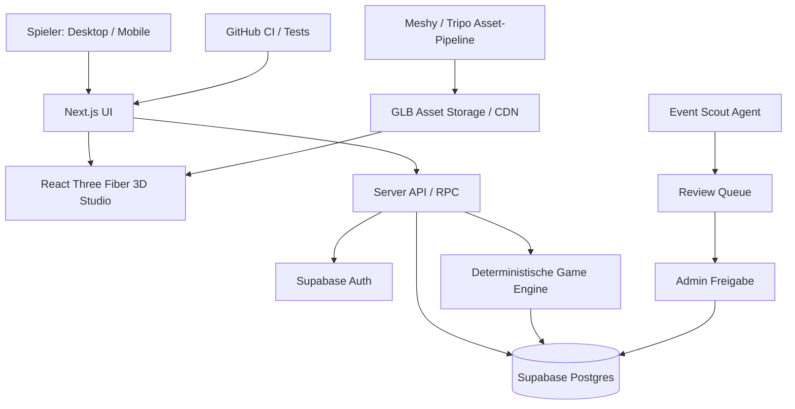

# CREATOR EMPIRE
## Produktkonzept, Game Design Document und technische Umsetzung

**Version:** 1.0 · **Stand:** 31. Oktober 2026  
**Status:** Konzept / MVP-Spezifikation · **Sprache:** Deutsch  
**Arbeitsname:** Creator Empire (vorläufig; Marken- und Domainrecherche vor Veröffentlichung)

> **Elevator Pitch:** Creator Empire ist ein persistentes, soziales Creator-Aufbau- und Agentur-Strategiespiel für den Browser. Spieler entwickeln fiktive Content Creator vom unbekannten Newcomer zum virtuellen Star, produzieren Inhalte mit realzeitbasierten Timern, verbessern Studios und Skills, managen Verträge und treten bei virtuellen Missionen an. Ein KI-Event-Scout entdeckt öffentliche reale Marken-Events, aus denen – nach Prüfung – unabhängige, klar als fiktiv gekennzeichnete Spiel-Challenges entstehen. Später können Brands offiziell kooperieren.

---

# 1. Vision und Produktidentität

## 1.1 Die Idee

Das langfristige Strategiespielgefühl von **OGame/SchoolWars** trifft auf die Creator-Kultur, das sichtbare Wachstum eines **Tycoon-Games**, die Avatar-Individualisierung eines Social Games und die wiederkehrenden Challenges einer Live-Service-Welt.

Der Spieler entscheidet: Was produziert mein Creator? Welche Skills und Studiotechnik rüste ich auf? Welche Marke und welches Event passen zu meinem Publikum? Welche Creator ergänzen mein Agentur-Roster? Eine gewählte Produktion (z. B. ein Reel) belegt einen Slot für vier Stunden Echtzeit; die Produktion läuft weiter, wenn der Browser geschlossen wird. Nach Fertigstellung werden Belohnungen serverseitig einmalig ausgezahlt. Entscheidungen und Entwicklungsstufen verändern nicht nur Zahlen, sondern **sichtbar die 3D-Welt und den Avatar**.

## 1.2 Produktversprechen

- **Build:** Starte mit einem Creator und einem einfachen Schlafzimmerstudio, baue ein Medien-Imperium auf.
- **Create:** Plane Content und starte zeitbasierte Produktionen mit unterschiedlichen Strategien.
- **Grow:** Entwickle Skills, Reputation, Community und virtuelle Follower.
- **Compete:** Kämpfe in asynchronen Team- und Event-Challenges um Rankings.
- **Collaborate:** Gründe Agenturen und spiele mit Freunden zusammen.
- **Discover:** Entdecke reale Brand-Events über redaktionell geprüfte Eventkarten; spiele dazu unabhängige virtuelle Missionen.

## 1.3 Klare Abgrenzung

Das Spiel produziert im MVP **keine echten Reels** und veröffentlicht keine Inhalte auf Social-Media-Plattformen. „Reel produzieren“ bedeutet eine **simulierte Ingame-Aktion** mit Timer und Spielwerten. Das ist wichtig für Aufwand, Rechte, Kosten und Spielbarkeit. Eine tatsächliche Content-Generierung/-Veröffentlichung wäre ein separates, späteres Opt-in-Feature.

Die Creator im Basis-Spiel sind **fiktive, vom Spieler gestaltete Identitäten**. Reale Creator werden nicht ohne Rechtsprüfung/Lizenz als spielbare Charaktere, digitale Doppelgänger oder offizielle Vertragspartner abgebildet.

## 1.4 Zielgruppen

**Primär:** 16–24 Jahre; sekundär 18–30 Jahre mit Interesse an Management- und Strategiespielen. Eine jüngere Zielgruppe würde zusätzliche Jugendschutz-, Moderations- und Datenschutzanforderungen auslösen. Beginn mit browserbasiertem Desktop + mobile-responsive UI, später gegebenenfalls PWA.

## 1.5 Hypothesen, die noch zu testen sind

1. Spieler kehren für fertige Produktionen und neue strategische Entscheidungen regelmäßig zurück.
2. Die sichtbare Studiometamorphose motiviert stärker als reines Zahlenwachstum.
3. Echte Brand-Events erhöhen die Relevanz virtueller Missionen.
4. Asynchrones, freundschaftliches Spielen sorgt für mehr Bindung als reine Solo-Progression.
5. Brands erkennen in organischer Event-Aufmerksamkeit einen nachvollziehbaren B2B-Mehrwert.

Diese Hypothesen sind **noch keine validierten Markt- oder Nutzungsfakten**.

---

# 2. Game Pillars: die fünf Grundsysteme

| Pillar | Spielerlebnis | MVP | Später |
|---|---|---|---|
| Creator Life | Eigener Avatar, Talentbaum, Karriere, Stil | 1 fiktiver Creator, 3 Skills | Roster, Skins, Spezialisierungen |
| Content Factory | Produktion, Timer, Ressourcen | Story, Reel, Video; 1 Slot | Slots, Mitarbeiter, Content-Kombos |
| Studio Tycoon | Sichtbare 3D-Ausbaustufen | Isometrisches Zimmer, 3 klickbare Stationen | Größeres Gebäude, Agenturzentrale |
| Brand World | Events und virtuelle Verträge | Manuell kuratierte fiktive Verträge | Event-Scout, echte Event-Verweise, Partnerkampagnen |
| Social Competition | Rankings, Team-Battles, Kooperationen | Asynchroner Wochen-Score | Agenturen, Turniere, kollaborative Aufträge |

**Designregel:** Keine Mechanik darf allein auf häufigem Einloggen beruhen. Strategie, Timing und Ausdruck sollen wichtiger sein als zwanghafte Anwesenheit.

---

# 3. Kern-Spielschleife

1. **Login/Check-in:** Spieler sieht fertige Produktionen, Einnahmen, Fortschritt und Event-Highlights.
2. **Entscheidung:** Spieler wählt einen Content-Typ, eine Strategie, ein Studio-Setup und ggf. einen Brand-Vertrag.
3. **Produktion starten:** Server prüft Kontostand, Energie, Slot, Level und Voraussetzungen; Ressourcen werden atomar reserviert/abgebucht; eine `completes_at`-Zeit wird gespeichert.
4. **Während der Produktion:** Spieler kann Skills planen, den Vertragsmarkt prüfen, ein Upgrade starten, Team-Missionen planen oder offline gehen.
5. **Abschluss:** Nach Endzeit kann der Auftrag serverseitig abgeschlossen werden; XP, Follower, Credits und Reputation werden **genau einmal** zugewiesen.
6. **Entwicklung:** XP erhöht Level, freigeschaltete Upgrades verändern Durchlaufzeiten, Qualität und die 3D-Welt.
7. **Event/Ranking:** Content-Beiträge ergeben Spiel-Scores für passende virtuelle Kampagnen; Spieler erhält Saisonpunkte und kosmetische Abzeichen.
8. **Nächster Zyklus:** Strategischer Einsatz der neuen Ressourcen.

## 3.1 Beispiel-Session

**Morgens (3–5 Min.):** Fertiges Reel abholen, Studio-Erweiterung anstoßen, neues Reel planen.  
**Mittags (5 Min.):** Event-Challenge ansehen, passenden Vertragsauftrag starten.  
**Abends (10–15 Min.):** Creator upgraden, mit Freund kooperieren, Wochenranking prüfen.  
**Wochenende:** Größere Brand-Battle-Challenge mit längerfristiger Strategie.

Dies sind **Designziele**, keine empirischen Nutzungszeiten.

---

# 4. Ressourcen, Attribute und Spielökonomie

## 4.1 Ressourcenmodell

| Ressource | Verwendung | Erwerb | Hinweise |
|---|---|---|---|
| Credits | Ausrüstung, Upgrades, Mitarbeiter, Produktionskosten | Missionen, virtuelle Verträge | Primäre erspielbare Währung |
| Creator XP | Creator-Level | Content, Herausforderungen | An Creator gebunden |
| Agency XP | Account-/Agentur-Level | Missionen, Ausbau | Schaltet Roster und Gebäude frei |
| Follower | Karriere-Reichweite, Vertragsvoraussetzung | Content-Ergebnisse | Virtuelle Zahl, **keine** echten Social-Follower |
| Reputation | Brand-Vertrauen/Qualität | Erfolgreiche Verträge, Event-Ziele | Nicht nur durch Reichweite ersetzbar |
| Energy / Fokus | Begrenzung paralleler Aktivitäten | Regeneration | Muss großzügig und fair gebalanced werden |
| Hype | Temporärer Eventsaison-Wert | Passende Kampagnen | Verfällt / wird saisonal zurückgesetzt |

## 4.2 Creator-Attribute (0–100)

- **Reach:** Wirkt auf potenziell erzielbare virtuelle Reichweite.
- **Engagement:** Community-Reaktion auf Formate.
- **Creativity:** Qualitäts- und Formatboni.
- **Production:** Zeit-/Qualitätsboni.
- **Brand Fit:** Passung zu Branchen und Eventbriefings.
- **Reliability:** Planbarkeit / Vertragsrisiko.

Jeder Creator besitzt eine **Nische** (z. B. Gaming, Fitness, Fashion, Tech), eine Charaktereigenschaft (z. B. experimentell, zuverlässig), und Skills.

## 4.3 Beispielhafte Startbalance (nicht final)

| Aktion | Grunddauer | Kosten | XP | erwartete Follower |
|---|---:|---:|---:|---:|
| Story | 30 Min. | 40 Credits | 30 | +90 |
| Reel | 240 Min. | 180 Credits | 150 | +850 |
| Longform-Video | 720 Min. | 550 Credits | 450 | +2.500 |
| Livestream | 360 Min. | 300 Credits | 250 | +1.250 |
| Event-Reel | 240 Min. + Briefing | variabel | +150 + Event-XP | abhängig vom Fit |

Die Beispiele sind **fiktive Balancing-Startwerte**. Der MVP startet beispielsweise mit **1 Creator, 500 Credits, 0 XP, 1 Produktionsslot, 1 Studio-Raum**. Die Startwirtschaft muss so getestet werden, dass der Spieler nach ersten Aktionen nicht in einem Ressourcen-Deadlock landet (z. B. kostenlose kleine Aufträge oder Start-Missionen).

## 4.4 Produktionsberechnung (Beispiel)

```ts
const durationMinutes = Math.max(
  10,
  Math.round(baseMinutes * (1 - equipmentLevel * 0.06 - productionSkill * 0.015))
);

const rawScore =
  0.25 * creator.reach +
  0.25 * creator.engagement +
  0.20 * creator.creativity +
  0.15 * creator.production +
  0.15 * brandFit;

const finalScore = Math.max(0, Math.min(100, rawScore + strategyBonus + seededVariance));
```

**Regeln:** Werte und Zufallsanteile werden serverseitig berechnet. Ein Ereignis nutzt pro Auftrag einen fixierten, serverseitigen Seed, damit die Ergebnisse reproduzierbar sind. Keine ungedeckelten multiplikativen Boni. Für Wettbewerbe getrennte, nachvollziehbare Scoreformel verwenden. Spieler sieht eine **Prognosebandbreite** statt angeblich garantierter Followerzahlen.

## 4.5 Progression

- **Level 1–10 / Newcomer:** eigenes Zimmer, erster Creator, Story/Reel, einfacher Skillbaum.
- **Level 11–25 / Rising Creator:** Kamera und Editing, erste mehrstufige Verträge, kleinere Event-Missionen.
- **Level 26–50 / Pro Creator:** Editor-Mitarbeiter, neue Slots und Agency-Aufträge.
- **Level 51+ / Creator Empire:** Agentur-HQ, mehrere Creator, Allianz- und Saisonwettbewerbe.

Nicht nur Level, sondern auch **Meilensteine, Reputation und verschiedene Skills** entscheiden über Unlocks. So entstehen unterschiedliche Spezialisierungen statt eines einzigen dominanten Builds.

## 4.6 Skill-Tree

```text
Smartphone Studio (Start)
├── Kamera & Licht ──> Videoqualität ──> Premium Production
├── Storytelling ──> Engagement ──> Community Management
├── Editing ──> Zeitreduktion ──> Production Team
└── Brand Management ──> Vertragsqualität ──> Agency Office
                                            └── Creator Roster
```

## 4.7 Vertragsmechanik

Ein Vertrag hat: **Briefing, virtuelles Brand-Profil, Nische, Mindestlevel, benötigte Reichweite/Reputation, erforderliches Content-Format, Frist, Produktionsslots, virtuelle Belohnung und Risikoindikator**.

Die virtuelle Vertragsannahme ist im Spiel **kein realer Rechtsvertrag** zwischen Nutzer, Creator und Marke.

---

# 5. Soziale Systeme und Wettbewerb

## 5.1 Asynchrone Battles

Spieler stellen aus ihren Creatorn Teams zusammen und senden Content-Produktionen für eine Mission ein. Nach Ablauf berechnet der Server Punkte anhand von Zielgruppenfit, Strategie, Qualität und begrenztem Seed-Zufall. Niemand muss gleichzeitig online sein.

## 5.2 Ranking-System

Unterscheide **Creator Level**, **Agency-Level**, **Event-Score** und **Saisonrang**. Matchmaking nach ähnlichem Fortschritt oder separate Ligen, damit etablierte Spieler Newcomer nicht dauerhaft verdrängen. Wöchentliche Belohnungen eher kosmetisch und reputationsbezogen; Saison-Resets betreffen Wettbewerbspunkte, nicht die gesamte Karriere.

## 5.3 Agenturen / Clans (nach MVP)

Member können Agenturen gründen; Rollen: Owner, Manager, Member. Agenturprojekte benötigen mehrere spezialisierte Creator, aber Solo-Spiel muss durch passende Alternativen möglich bleiben. Gemeinsame Gebäude und Team-Verträge benötigen Berechtigungssysteme sowie Missbrauchsschutz.

## 5.4 Shareability

Teilbare **Ergebniskarten**, virtuelle Creator-Profile und 3D-Studio-Screenshots. Öffentliche Profile mit Datenschutz- und Jugendschutzvorgaben; Teilen ist freiwillig. Keine Nutzung fremder Creator-Fotos ohne Rechte.

---

# 6. Real Brand Event Scout

## 6.1 Produktidee

Ein KI-Agent entdeckt **öffentlich angekündigte, nachprüfbare** Marken-Events und Kampagnen, schlägt redaktionelle Kurzbeiträge vor und erzeugt **unabhängige virtuelle Event-Missionen**. Spieler können diese mit ihren fiktiven Creator-Teams spielen. Dadurch können Events zusätzliche Aufmerksamkeit erhalten. Eine eventuelle Marketingwirkung ist erst nach Tracking/Studien belegbar.

## 6.2 Workflow

1. **Discover:** offizielle Event-Websites, öffentliche Pressemitteilungen, Veranstalterkalender, RSS/zugelassene APIs.
2. **Normalize:** Name, Veranstalter, Datum/Zeitzone, Ort/Online-Link, Zielgruppe, Nische, Quell-URL, Auslastungs-/Terminstatus, Abrufzeit.
3. **Deduplicate:** ähnliche Events zusammenführen; Dubletten markieren.
4. **Verify:** Originalquelle prüfen; Aktualität und Änderungen verfolgen.
5. **Rights Check:** Darf der Name sachlich genannt werden? Sind Bilder/Logos lizenziert? Könnte offizielle Beteiligung suggeriert werden?
6. **Generate:** Missionstyp, Laufzeit, Skill-Anforderungen, Budget, klare fiktive Rewards und Scoring.
7. **Review:** menschliche Freigabe von Eventkarte und Mission im Admin-Panel.
8. **Publish:** Eventartikel und optional spielbare Mission; deutlicher Hinweis „unabhängige, fiktive Challenge“.
9. **Monitor:** Terminänderungen, Absagen, Beschwerden; ggf. pausieren/entfernen.
10. **Measure:** Impressionen, Klicks zur offiziellen Seite, Challenge-Teilnahmen, freiwillige Shares, wiederkehrende Spieler.

## 6.3 Event-Status

`discovered -> normalized -> awaiting_review -> approved -> published -> updated|cancelled|archived`

Separate Felder: `is_official_partner`, `sponsorship_disclosure`, `image_license`, `editorial_source_urls`, `last_verified_at`. „Official Partner“ ausschließlich nach dokumentiertem Nachweis aktivieren.

## 6.4 KI ist nicht das Regelwerk

Die KI darf **Briefings und thematische Vorschläge** erstellen. Sie soll nicht frei bestimmen, welcher Spieler gewinnt, und nicht unkontrolliert Markenbehauptungen veröffentlichen. Produktions- und Battle-Scoring laufen deterministisch auf dem Server. KI-generierte Veröffentlichungen gehen durch Prüfung.

## 6.5 MVP-Alternative

Zuerst **manuell kuratierte fiktive Brand-Missionen** und eine kleine Zahl redaktionell gepflegter realer Eventkarten ohne Drittbilder einsetzen. Agenten-Automatisierung erst nach erfolgreichem Core-Loop ergänzen.

---

# 7. Grafik, UI/UX und 3D-Welt

## 7.1 Art Direction

**Hybrid aus OGame-Dashboard und modernem stylisierten 3D-Tycoon:** dunkle Oberfläche, gut lesbare Karten, warme Neon-Akzente, visuell kräftiger Fortschritt, zugängliche Mobilansichten. 3D **isometrisch** statt riesiger frei begehbarer Open World. PC: persistente Ressourcenleiste und Navigation. Mobile: Bottom Navigation mit Studio, Creator, Content, Events und Agency.

**Designziele:** gute Kontraste, reduzierte Animation (Reduced Motion), klare Statusfarben, kein wichtiges Feedback nur über Farbe, Tastaturbedienung für Kernaktionen.

## 7.2 Hauptscreens

1. **HQ/Studio:** klickbare 3D-Zentrale, laufende Produktionsanimationen, Slots, Upgrade-Visuals.
2. **Creator Profile:** Avatar, Ausrüstung, Nische, Follower, XP, Skills, Karrierepfad.
3. **Content Studio:** Content-Auswahl, Strategiekarten, Kosten, Dauer, erwarteter Output, Startbutton.
4. **Production Queue:** aktive Prozesse, serverbasierter Resttimer, Abschluss/Claim.
5. **Contract Market:** Filter nach Nische/Level, Briefing, Bedingungen, Frist, Rewards.
6. **Event Hub:** reale redaktionelle Events, unabhängige virtuelle Challenges, Partnerkennzeichnung.
7. **Leaderboard/Season:** Divisionen, Ergebnisse, Verlauf, Freundesvergleich.
8. **Agency (später):** Roster, Mitarbeiter, Rollen und gemeinsamer Ausbau.
9. **Admin Console:** Event-Review, Rechtehinweise, Moderation und Wirtschaftskonfiguration.

## 7.3 MVP-Welt

Ein Raum als kleine isometrische 3D-Szene mit diesen Instanzen:

- **Creator Avatar** (anfangs prozedurale Figur oder ein validiertes GLB)
- **Kamerastation** (Reels)
- **Streaming-Schreibtisch** (Lives)
- **Editing-Desk** (Postproduktion)
- **Upgrade-Platz** (Studioentwicklung)

Klick auf ein Objekt öffnet ein **2D-Overlay** für Details. Komplexe Formulare und Timer **nicht** als schwer lesbare 3D-Texte umsetzen.

## 7.4 Visuelle Entwicklungsstufen

| Phase | Sichtbare Veränderungen |
|---|---|
| Bedroom | kleines Zimmer, Handy, einfacher Tisch |
| Rising Studio | bessere Kamera, LED-Licht, weiteres Set |
| Professional | Editing-Raum, Mitarbeiter, mehrere Stationen |
| Agency | Empfangsbereich, Vertragstafel, Creator-Roster |
| Empire | größeres HQ, Event-Wall, mehrere Studiobereiche |

## 7.5 3D-Charakter-Pipeline

**Empfohlen:** Ein konsistenter stilisierter Basis-Avatar mit austauschbaren Haaren, Outfits, Accessoires und Farben, nicht für jeden Member ein zufällig neu generierter und inkompatibler Mesh.

1. Styleguide und Character-Sheet erstellen.
2. 3D-Basis in Meshy/Tripo generieren oder ein passend lizenziertes Basisasset verwenden.
3. Mesh prüfen: Polygonzahl, UVs, Materialanzahl, Topologie, Lizenz, Dateigröße.
4. Rigging, idealerweise auf einem gemeinsamen Skelettstandard.
5. Animationen: Idle, Walk, Recording, Editing, Streaming, Celebrate.
6. Export als `.glb`, Kompression/LOD/Texture-Optimierung.
7. Avatar-Varianten durch modulare Teile konfigurieren; nicht durch generative Echtzeitproduktion pro Spieler.

**Beispiel-Avatar-Konfiguration:**

```json
{
  "baseModel": "creator_base_v1",
  "skinTone": "tone_04",
  "hair": "short_wavy_02",
  "outfit": "streetwear_03",
  "accessories": ["headphones_01"],
  "animationSet": "creator_humanoid_v1"
}
```

Meshy bietet Text-zu-3D und Rigging-APIs; Auto-Rigging funktioniert jedoch am besten mit klar humanoiden Figuren. Ergebnisse müssen getestet und möglicherweise nachbearbeitet werden.

## 7.6 3D-Welt-Pipeline

1. Grundriss/Objektpositionen in **JSON/TypeScript** definieren.
2. Für MVP Stationsgeometrie prozedural im Code erzeugen.
3. Assetbibliothek mit einheitlichen Maßen, Pivot-Punkten und Art Direction aufbauen.
4. Generator erstellt GLB-Assets als **Entwicklungs-/Build-Artefakte** (nicht pro Seitenaufruf).
5. Asset-Validierung, Performance-Test und Integration in React Three Fiber.
6. Upgrade-Status schaltet vordefinierte Varianten frei (z. B. `camera_station_lv1.glb` / `lv2.glb`).
7. Kamera isometrisch fixieren bzw. Bewegung begrenzen; Objekt-Hover/Klick unterstützt Touch.

---

# 8. Technikarchitektur: Vibe Coding von Anfang an

## 8.1 Empfohlener Stack

| Ebene | Technologie | Begründung |
|---|---|---|
| Agentisches Coding | Cursor **oder** Codex/Claude Code | Aufgaben in natürlicher Sprache, Dateien ändern, testen |
| Frontend | Next.js + TypeScript + Tailwind CSS | Web-App, responsive UI, gemeinsame Codebasis |
| 3D | Three.js + React Three Fiber + Drei | Browserfähige isometrische Szenen, GLB-Import |
| Local State | Zustand | UI, Auswahl und Caches; keine authoritative Game-Werte |
| Backend | Supabase Auth + PostgreSQL | Identität, Persistenz, SQL-Transaktionen |
| API | Next.js Server Routes / Supabase RPC / Edge Functions | Serverseitige Aktionen und Validierung |
| Event Jobs | Supabase Cron / externe Jobs | Event-Sync und Notifications, **nicht** je Reel ein laufender Prozess |
| Asset-Generierung | Meshy oder Tripo | GLB-Bausteine, optionale Rigging-/Animations-Pipeline |
| Hosting | Vercel + Supabase | Deployment und Datenhaltung getrennt |
| Repo/CI | GitHub + GitHub Actions | Review, Tests, automatisierte Builds |
| Observability | Error Tracking + strukturierte Logs | Produktionsfehler, Spielbetrug, Performance |

**Alternative:** PlayCanvas eignet sich besonders, wenn 3D-Gametechnik dominanter wird; offiziell dokumentierte AI-Code-Workflows unterstützen entsprechende Agenten. Für dieses stark UI-/Datenbankgetriebene Tycoon-Projekt bleibt **Next.js + R3F** die Primärempfehlung.

**Versionshinweis:** Vor Projektstart kompatible Versionen, aktuelle Lizenzbedingungen und Anbieterpreise erneut prüfen. Nicht blind Pakete mit `latest` kombinieren.

## 8.2 High-Level-Diagramm



## 8.3 Repository-Struktur

```text
creator-empire/
  app/
    (auth)/login/
    (game)/studio/
    (game)/creators/
    (game)/content/
    (game)/contracts/
    (game)/events/
    (game)/rankings/
    api/game/
    api/admin/
  components/
    ui/
    game/
    three/
  features/
    creators/
    production/
    upgrades/
    contracts/
    events/
    battle/
  lib/
    game-engine/       # serverseitige pure Berechnungen
    supabase/
    validation/
  assets/
    models/
    manifests/
  supabase/
    migrations/
    tests/
    seed.sql
  tests/
    unit/
    integration/
    e2e/
  docs/
    architecture.md
    economy.md
    assets.md
    legal-review.md
  .github/workflows/
```

## 8.4 Datenmodell (vereinfachter Vorschlag)

| Tabelle | Wichtige Spalten | Zweck |
|---|---|---|
| `profiles` | `id`, `display_name`, `created_at` | Spielerprofil |
| `accounts` | `user_id`, `credits`, `agency_xp`, `agency_level`, `energy` | Ressourcen und Fortschritt |
| `creators` | `id`, `owner_id`, `name`, `niche`, `level`, `xp`, `followers`, `reputation`, `avatar_config` | Fiktive Creator |
| `creator_skills` | `creator_id`, `skill_key`, `level` | Skills |
| `studio_upgrades` | `user_id`, `upgrade_key`, `level` | Studios |
| `production_slots` | `id`, `creator_id`, `slot_index`, `unlocked` | Kapazität |
| `production_jobs` | `id`, `owner_id`, `creator_id`, `kind`, `strategy`, `started_at`, `completes_at`, `claimed_at`, `status`, `seed`, `reward_snapshot` | Persistente Timer |
| `game_ledger` | `id`, `owner_id`, `source_type`, `source_id`, `currency`, `delta`, `created_at` | Auditierbare Buchungen |
| `contracts` | `id`, `title`, `briefing`, `requirements`, `rewards`, `expires_at`, `kind` | Virtuelle Verträge |
| `contract_assignments` | `id`, `owner_id`, `creator_id`, `contract_id`, `status` | Annahmen |
| `events` | `id`, `title`, `source_url`, `start_at`, `end_at`, `review_status`, `is_official_partner`, `last_verified_at` | Eventkarten |
| `event_missions` | `id`, `event_id`, `rules_json`, `start_at`, `end_at`, `review_status` | Virtuelle Event-Challenges |
| `mission_entries` | `id`, `owner_id`, `mission_id`, `team_json`, `score` | Wettbewerbseinträge |
| `agency_memberships` | `agency_id`, `user_id`, `role` | Spätere Teams |

**Constraints:** Unique-Keys für `game_ledger(source_type, source_id, currency)` bzw. geschäftsvorgangsspezifische Transaktions-IDs; Foreign Keys; Indexe für `completes_at`, `owner_id`; `CHECK`-Constraints gegen negative Credit-Bestände (soweit passend), `timestamptz` für UTC-Zeitpunkte.

## 8.5 API-Kommandos

```text
POST /api/game/production/start
POST /api/game/production/claim
GET  /api/game/state
POST /api/game/upgrades/start
POST /api/game/contracts/accept
GET  /api/game/events
POST /api/game/missions/enter
GET  /api/game/leaderboard
```

Nur **authentifizierte, servervalidierte** Kommandos dürfen Spielwerte verändern. Keine direkten Client-Updates an Credits, XP, Follower oder Rewards.

## 8.6 Exemplarischer Start-Workflow

```text
POST /production/start(kind='reel', strategy='viral', creator_id)
  -> Auth prüfen
  -> idempotency_key validieren
  -> DB-Transaktion starten
  -> Account + Slot sperren
  -> Creator-Besitz, Skill- und Levelvoraussetzungen prüfen
  -> Realkosten und Dauer serverseitig berechnen
  -> Credits atomar abbuchen und Ledger-Eintrag schreiben
  -> Job mit now() und completes_at = now() + duration speichern
  -> Transaktion committen
  -> Job / Endzeit an Client zurückgeben
```

**Claim:** Gesperrten Job laden; `now() >= completes_at` prüfen; `claimed_at IS NULL` und `status = running` prüfen; Rewards serverseitig aus gespeichertem Snapshot/Seed ermitteln; Status/Claim und Ledger **in derselben Transaktion** speichern; erneuter Claim liefert dieselbe abschließende Antwort, keine zweite Auszahlung.

**Wichtig:** PostgreSQL-Funktionen oder eine entsprechende transaktionale Backend-Schicht sind für die atomare Ressourcenkonsistenz geeignet; eine bloße Folge ungeschützter Browser-Requests reicht nicht.

## 8.7 Timer-Implementierungsprinzip

```ts
// Clientseitige ANZEIGE, nicht vertrauenswürdige Spielwahrheit
const remainingMs = Math.max(0, Date.parse(completesAt) - estimatedServerNowMs);

// Serverseitiger Abschluss nur, wenn DB now() >= completes_at
// Erneute Rewards durch Status-/Claim-Sperre ausgeschlossen
```

Server- und Browserzeit müssen für die Anzeige abgeglichen werden; die Datenbankzeit entscheidet. Nicht pro Reel einen vierstündigen Background-Worker betreiben.

## 8.8 Sicherheit und Betrieb

- **Row Level Security** für alle exponierten Supabase-Tabellen, streng kontrollierte Grants und Policies.
- Privilegierte Funktionen mit minimalen Rechten und sorgfältiger `search_path`-Konfiguration.
- API-Keys nur serverseitig; niemals Supabase-Service-Role- oder Asset-Generator-Secrets ins Frontend.
- Inputvalidierung (z. B. Zod), Rate-Limiting, Idempotenz, Replay- und Bot-Schutz.
- Transaktions- und Buchungslogs bei Credits, XP und Event-Rewards.
- Ownership-Checks, Anti-Cheat, serverseitige Seeds, reproduzierbares Battle-Scoring.
- Assetgrößen, LOD, GPU-Budget, Lazy Loading, Fallback für leistungsschwache Smartphones.
- Datenschutz: Datenminimierung, Lösch-/Exportprozesse, Moderation, Meldesysteme.
- Backups, Staging, Rollbacks und automatisierte Tests.

---

# 9. Die Vibe-Coding-Arbeitsweise

## 9.1 Was vollständig promptgesteuert möglich ist

- Projektgerüst und UI-Screens
- React-Three-Fiber-Szenen mit prozeduraler Geometrie
- API-Endpunkte, Datenbankmigrationen und Game Rules
- Tests, CI, Dokumentation, Refactoring
- Einbindung bereits erzeugter GLB-Assets
- Entwürfe für Event-Missionen und Content-Texte

## 9.2 Wo externe Schritte nötig bleiben

- 3D-Assets benötigen meist Generation, Sichtprüfung, Animation/Rigging und Optimierung.
- Ein konsistenter Avatarbaukasten ist anspruchsvoller als einzelne KI-Charakterbilder.
- Accounts/API-Keys/Zahlungsdienste/Deploymentberechtigungen müssen eingerichtet werden.
- Spielbalance und Spaß müssen mit echten Nutzern getestet werden.
- Marken-/Bild-/Persönlichkeitsrechte, Moderation und Datenschutz lassen sich nicht durch einen Coding-Prompt ersetzen.

**Ziel:** 90 % der Tätigkeiten können in einem KI-geführten Workflow beauftragt und iteriert werden; dies ist **ein Entwicklungsziel, keine garantierte Automatisierungsquote**.

## 9.3 Arbeitsregeln für Coding-Agenten

1. Lies zuerst `docs/architecture.md`, `docs/economy.md` und die relevanten Feature-Dateien.
2. Plane nur eine abgeschlossene vertikale Funktion auf einmal.
3. Ändere Game-Economy-Regeln nicht ohne Tests und dokumentierte Balancing-Änderung.
4. Client ist nie autoritativ für Spielwerte.
5. Schreibe Migration, Backend, Frontend und Tests gemeinsam.
6. Führe `lint`, `typecheck`, Unit- und Integrationstests aus.
7. Erstelle vor Asset-Integration einen funktionsfähigen Platzhalter.
8. Halte UI und 3D-Szene auf schwächeren Geräten lauffähig.
9. Zeige am Ende der Iteration Änderungen, Tests, Screenshots/Preview und offene Risiken.

## 9.4 Master Prompt für den Coding-Agenten

```text
Du bist Lead Game Engineer, Backend Architect und Technical Artist.
Baue Creator Empire als browserbasiertes, persistentes, isometrisches
Creator-Tycoon-Strategiespiel gemäß diesem GDD.

Stack: Next.js, TypeScript, Tailwind, React Three Fiber/Drei,
Supabase Auth/Postgres/RPC und Zustand für lokalen UI-State.

Arbeite in vertikalen Slices. Beginne mit einem Spieler,
einem Creator, einem 3D-Raum, einer Reel-Produktion (4h),
serverseitigem Timer, einmaligem Claim, XP/Followern und
einem sichtbaren Studio-Upgrade.

Security: serverautoritatives Gameplay, RLS, Transaktionen,
Idempotenz, Ownership-Checks, keine Secret-Leaks.

Erstelle zuerst: Architekturüberblick, Schema/Migrationen,
Feature-Plan, Tests, anschließend die kleinste lauffähige Version.
Verwende 3D-Platzhalter bevor du externe Assets integrierst.

Führe Tests aus und melde nachvollziehbar, was funktioniert.
``` 

## 9.5 Prompt: 3D-Studioraum

```text
Implementiere eine isometrische React-Three-Fiber-Szene: Boden,
Rückwände, Creator-Platzhalter, Kamera-Station, Streaming-Desk,
Editing-Station. Jede Station ist per Maus und Touch anwählbar.
Öffne bei Klick ein zugängliches 2D-React-Panel.
Zeige bei laufender Produktion einen Statusindikator an.
Verknüpfe jede Station mit dem serverseitigen production_jobs-Status.
Wähle performante Geometrien und responsive Kamera-Framing.
Schreibe Playwright-Tests für die Kerninteraktion.
```

## 9.6 Prompt: sicheres Produktionssystem

```text
Implementiere die vollständige Start- und Claim-Logik für
production_jobs mit Postgres-Transaktionen, idempotency_key,
RLS-Tests, serverseitiger Zeit, Ressourcenabbuchung und
Einmal-Auszahlung. Berücksichtige parallele Tabs, doppelte
Requests, abgelaufene Jobs und fehlende Credits. Lege
Unit-, Integrations- und Concurrency-Tests an.
```

## 9.7 Prompt: 3D-Asset-Pipeline

```text
Entwickle eine Asset-Manifest-Struktur für 3D-Studiomöbel:
asset_id, version, pivot, bounding_box, thumbnail, glb_url,
polycount, texture_memory, license, source, animation_set.
Binde zunächst GLB-Platzhalter ein. Erstelle einen Validierungs-
Workflow für neue Meshy-Assets und sichere einen Fallback bei
fehlgeschlagener Asset-Ladung ab.
```

## 9.8 Prompt: Event-Scout (erst nach Core-MVP)

```text
Baue einen Event-Scout, der nur zugelassene öffentliche Quellen
abruft, Quelle/URL/Daten/Zeitstempel speichert, Dubletten erkennt
und Vorschläge für fiktive Missionen erstellt. Veröffentlichung
nur nach Admin-Freigabe. Kein ungeprüftes Scraping, keine
unerlaubte Bild-/Logonutzung und keine falschen Partnerschaftsclaims.
Implementiere Statuswechsel, Audit-Log und Entpublizierung.
```

---

# 10. MVP-Umfang, Abnahmekriterien und Roadmap

## 10.1 MVP: „One Creator, One Room, One Reel“

**Enthalten**

- Registrierung/Login; Startcreator; sichere Spielstände.
- 3D-Zimmer mit drei anklickbaren Stationen und Platzhalteravatar.
- Story und Reel als Content-Jobs, konfigurierte Dauer und Ressourcen.
- Produktionswarteschlange, Offline-Fortschritt und einmalige Rewards.
- XP-/Levelsystem, virtuelle Follower und Credits.
- Ein sichtbares Studio-Upgrade, das Zeit oder Qualität verändert.
- Drei fiktive Verträge und eine manuell gepflegte Challenge.
- Responsives UI, Fehlerbehandlung, einfache Analytics.

**Nicht enthalten**

- Große frei begehbare Stadt, volle Multiplayer-Live-Synchronisation.
- Hunderte KI-Avatare, offene generative Inhalte, reale Creator-Doubles.
- Vollautomatisch veröffentlichender Event-Agent.
- Echtgeld-Einsatz, Lootboxen, Social-Publishing oder echte Werbeverträge.

## 10.2 MVP-Akzeptanzkriterien

1. Ein Spieler kann sich registrieren und nach erneutem Login denselben Stand sehen.
2. Start eines Reels speichert zuverlässig Start-/Endzeit serverseitig.
3. Ein Job wird offline fertig und ist danach abrufbar.
4. Mehrfaches Claiming, parallele Tabs und Refresh erzeugen **keine** doppelten Rewards.
5. Fehlende Credits oder besetzte Slots blockieren den Start konsistent.
6. Der Creator erhält nach dem Claim richtige XP/Level/Follower.
7. Ein Studio-Upgrade zeigt sich sichtbar in der 3D-Szene und wirkt auf eine definierte Regel.
8. Die mobile Oberfläche bleibt ohne 3D-Absturz verwendbar; 2D-Fallback vorhanden.
9. Ein fiktiver Brand-Vertrag kann akzeptiert und abgeschlossen werden.
10. Tests für RLS und Game Economy laufen automatisiert.

## 10.3 Entwicklungsphasen (Meilensteine, keine Zeitversprechen)

| Phase | Ergebnis | Exit Gate |
|---|---|---|
| A – Foundation | Repo, Auth, Postgres, Tests, CI | Login und Datenpersistenz sicher |
| B – Core Loop | Reel-Timer, Claim, XP, Studio-Upgrade | Offline-/Concurrency-Tests bestehen |
| C – Visual Tycoon | 3D-Studio und Creator-Avatar | Performance und UX getestet |
| D – Contracts | virtuelle Verträge, Reputation | Spielökonomie stabil |
| E – Social | Weeklies, Freunde, asynchrone Battles | Fairness-/Abuse-Tests |
| F – Event Scout | Fundstellen, Quellen, Admin Review | Rechtliche/redaktionelle Freigabeprozesse |
| G – Brand Partnerships | offizielle Sponsored Missions | Verträge, Kennzeichnung, Reporting |

## 10.4 Frühe KPI-Messung

- **Activation:** Anteil, der in erster Session ein Reel startet und den ersten Claim erlebt.
- **Time to First Fun:** Zeit bis zur ersten verständlichen Fortschrittsbelohnung.
- **D1/D7 Retention:** Rückkehr an Tag 1 und 7.
- **Loop Health:** Produktionsstarts, abgeschlossene Claims, brachliegende Slots.
- **Progression:** Zeit bis zum ersten Upgrade, Ressourcenklemmen.
- **Social:** Anteil mit erster Challenge oder Freunde-Interaktion.
- **Brand:** qualifizierte Event-Views, Klicks auf offizielle Quelle, Challenge-Starts.

Keine konkreten Zielzahlen als Fakten ausgeben; sinnvolle Targets aus Playtests und Kohorten ableiten.

---

# 11. Geschäftsmodell

## 11.1 B2C

Kostenloses Basisspiel, optionale **rein kosmetische** Avatar-, Studio- und Agenturdesigns; eventuell nicht kompetitive Komfortoptionen. Keine bezahlten Kampfboni; besondere Vorsicht bei minderjährigen Spielern. Werbelast und tägliche Pflichtmechaniken gering halten.

## 11.2 B2B

- Gesponserte, eindeutig markierte offizielle Brand-Missionen.
- Event-Partnerseiten mit von Brands freigegebenen Assets.
- Aggregierte, datenschutzkonforme Kampagnenberichte.
- Community-Challenges, ohne bezahlte Vorteilspunkte für Teilnehmer.

Brand-Reports zeigen **virtuelle Spielinteraktionen** und ggf. gemessene externe Klicks – **keine behauptete echte Creator-Kampagnenleistung**.

## 11.3 Monetarisierungsgrundsatz

**Kein Pay-to-Win**; keine unklaren Echtgeld-/Zufallsgewinne. Bei Kooperationen klare Sponsoring-Kennzeichnung. Nutzer- und Jugendschutz vor kurzfristigen Umsatzzielen.

---

# 12. Rechte, Datenschutz, Sicherheit und Moderation

**Kein Rechtsgutachten; fachliche Prüfung vor Launch empfohlen.**

- **Reale Creator:** Künstler-/Profilnamen können Namens-, Marken- und Persönlichkeitsrechte betreffen. Die bloße sachliche Erwähnung ist rechtlich anders zu bewerten als kommerziell spielbare Abbilder, KI-Stimmen oder Avatare. Für Letztere im Regelfall ausdrückliche Rechteklärung einplanen.
- **Brands und Events:** reale Veranstaltungsinformationen sachlich, korrekt und mit Quellenbeleg darstellen; keine unberechtigte offizielle Partnerschaft behaupten. Marken-/Logoeinsatz, Bildrechte und eventuelle Veranstalterbedingungen separat prüfen.
- **Assets:** nur eigene oder nachweisbar lizenzierte 3D-Modelle, Musik, Fonts, Fotos und Grafiken. Lizenz- und Herkunftsmetadaten im Asset-Manifest speichern; Rechte an generierten Assets anhand der Anbieterbedingungen prüfen.
- **Nutzerdaten:** DSGVO-Rechtsgrundlagen, Datenschutzerklärung, Löschung/Export, Datenminimierung, besondere Anforderungen bei Minderjährigen.
- **Moderation:** Namensfilter für User-Creator, Report/Block, keine gezielte Nachbildung realer Personen oder diffamierende Inhalte. Für offene Chats strengere Moderation; für MVP besser kein offener Chat.
- **Spielmechanik:** kein Echtgeldglücksspiel, keine irreführenden garantierten Belohnungen oder manipulativen Kauf-/Countdown-Muster.
- **Sponsoring:** bezahlte Kooperationen unmissverständlich kennzeichnen.
- **Betrieb:** Rate-Limits, Bot-Abwehr, Abuse-Logs, klare AGB und Verfahren für Rechteinhaberbeschwerden.

---

# 13. Risiken und Gegenmaßnahmen

| Risiko | Auswirkung | Gegenmaßnahme |
|---|---|---|
| Content-Timer sind langweilig | geringe Retention | kurzer Start-Loop, sichtbare Upgrades, parallele Entscheidungen, Social Challenges |
| 3D zu teuer/langsam | Performance-/Budgetprobleme | isometrischer Einzelraum, LOD, GLB-Budget, 2D-Fallback |
| AI-Assets inkonsistent | unstimmige Avatarwelt | Basisrig, Styleguide, modulare Assets, Asset-QA |
| Wirtschaft kippt | Inflation/Softlock/Pay-to-Win | Ledger, Simulationen, Balancing-Telemetrie, Konfig-Versionen |
| Exploits / Doppelauszahlung | Ressourcenbetrug | Transaktionen, Idempotenz, RLS, Concurrency-Tests |
| Fehlende Brand-/Creator-Rechte | Beschwerden/Reputationsverlust | fiktiver MVP, Event-Freigabe, Lizenzdokumentation |
| Event Agent halluziniert | falsche Angaben | Originalquellen, menschliche Freigabe, Aktualitätschecks |
| Junge Nutzer / Moderation | Rechts-/Safety-Risiken | Schutzkonzept, Datensparsamkeit, begrenzte soziale Features |
| Umfang wächst zu schnell | Projekt kommt nicht zum Launch | vertikale Slices und harte MVP-Gates |

---

# 14. Unmittelbarer Arbeitsplan

1. **Repo + Entscheidungsdokument erstellen:** Architektur, Versionen, Spielregeln, Coding-Agent-Anweisungen.
2. **Supabase Auth und Schema aufsetzen:** zunächst `accounts`, `creators`, `production_jobs`, `game_ledger`.
3. **Eine serverseitige Reel-Transaktion bauen:** Start, vier Stunden, Claim, Anti-Duplikate.
4. **2D-Prototyp testen:** Spieler muss Credits, Produktion, XP und ersten Upgrade-Loop verstehen.
5. **3D-Zimmer ergänzen:** zunächst einfache prozedurale Geometrie statt Asset-Aufwand.
6. **Avatar und zwei Upgradestufen integrieren:** erst jetzt externe generierte Modelle.
7. **Fiktive Verträge und Event-Challenge hinzufügen.**
8. **Kleinen geschlossenen Test durchführen:** Beobachten, ob Spieler freiwillig zurückkehren und Spaß am Ausbau haben.
9. **Später Event-Agent mit redaktioneller Freigabe ergänzen.**

**Leitprinzip:** *Erst ein funktionierender, fairer Core-Loop. Dann eine schöne 3D-Welt. Danach die soziale Creator-Wirtschaft und die echte Event-Welt.*

---

# 15. Quellen / technische Referenzen

**Offizielle Dokumentation / Anbieterquellen (abgerufen bzw. geprüft am 31.10.2026):**

1. Cursor, *Agentic Coding*: https://prod.cursor.com/help/ai-features/agentic-coding
2. React Three Fiber, *Your First Scene / GLTF Loading*: https://r3fdocs.vercel.app/getting-started/your-first-scene
3. Supabase, *Database Functions*: https://supabase.com/docs/guides/database/functions
4. Supabase, *Row Level Security*: https://supabase.com/docs/guides/database/postgres/row-level-security
5. Meshy, *Text to 3D API*: https://docs.meshy.ai/en/api/text-to-3d
6. Meshy, *Rigging API*: https://docs.meshy.cn/en/api/rigging
7. PlayCanvas, *Developing with AI*: https://developer.playcanvas.com/user-manual/engine/developing-with-ai/

**Hinweis zu Marktdaten:** Die UX- und Game-Mechanik-Empfehlungen orientieren sich an bekannten Mustern von Aufbau-, Social- und Creator-Games. Konkrete Behauptungen über Gen-Z-/Gen-Alpha-Vorlieben und Marktgrößen sind in diesem Dokument bewusst **nicht** als verifizierte aktuelle Kennzahlen dargestellt; vor einem Investment-Pitch wäre eine getrennte, quellenkritische Marktanalyse sinnvoll.

---

## Anhang A: Definition of Done je Feature

- [ ] Nutzerproblem und Spielnutzen definiert
- [ ] UI-Zustände für Loading, Error, Empty und Success
- [ ] Serverseitige Autorisierung und Eingabevalidierung
- [ ] Datenbankmigration inkl. RLS/Grants
- [ ] Deterministische Regelberechnung + Balancing-Test
- [ ] Idempotenz-/Concurrency-Test bei Spielwertänderung
- [ ] Mobile, Touch und Tastatur getestet
- [ ] 3D-Fallback/Performance geprüft
- [ ] Analytics-Ereignis und Observability
- [ ] Dokumentation und Tests in CI grün

## Anhang B: Offene Produktentscheidungen

1. Startet jeder Nutzer mit einem einzigen frei gestalteten Creator oder wählt er einen von mehreren Archetypen?
2. Wie viele parallele Produktionen fühlen sich strategisch interessant, aber nicht überfordernd an?
3. Wird ein Auftrag automatisch fertiggestellt oder muss er aktiv geclaimt werden? (Empfehlung: fertig bei Endzeit, Claim als Belohnungsmoment; serverseitig keine unfairen Verluste bei Pausen.)
4. Soll Studioausbau nur optisch sein oder mechanische Boni geben? (Empfehlung: beides, aber fair.)
5. Wie stark soll Zufall das Event-Ergebnis beeinflussen? (Empfehlung: begrenzt und transparent.)
6. Werden Community-Battles erst nach Level 5 oder sofort freigeschaltet? (Im Playtest klären.)
7. Welche realen Event-Quellen sind vertraglich und technisch nutzbar?
8. Welche Altersgruppe wird rechtlich und im Marketing explizit adressiert?

*Ende des Gesamtkonzepts.*
